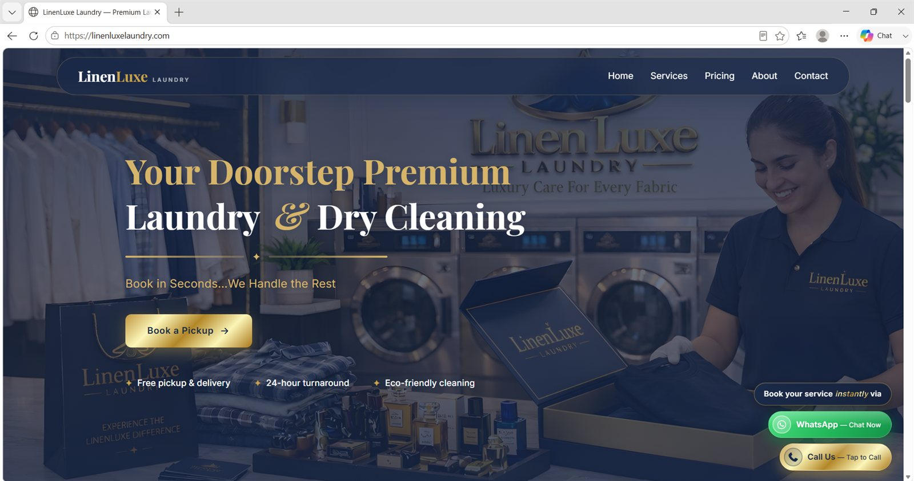
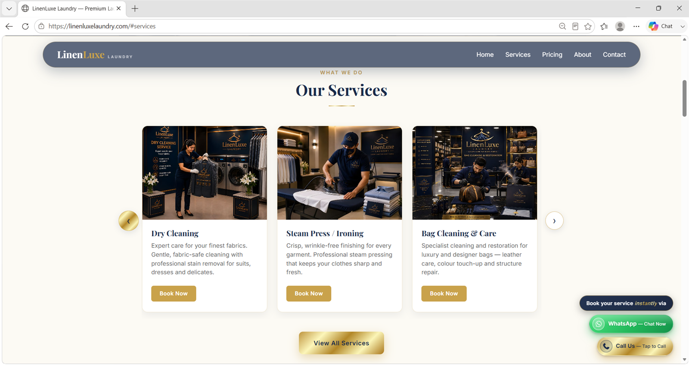
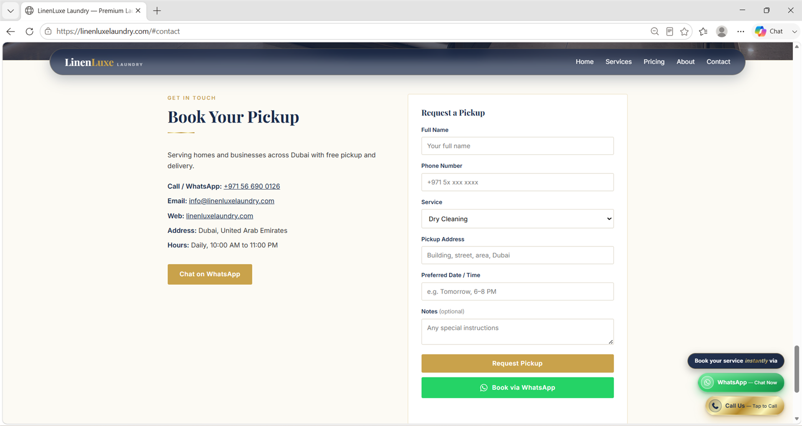
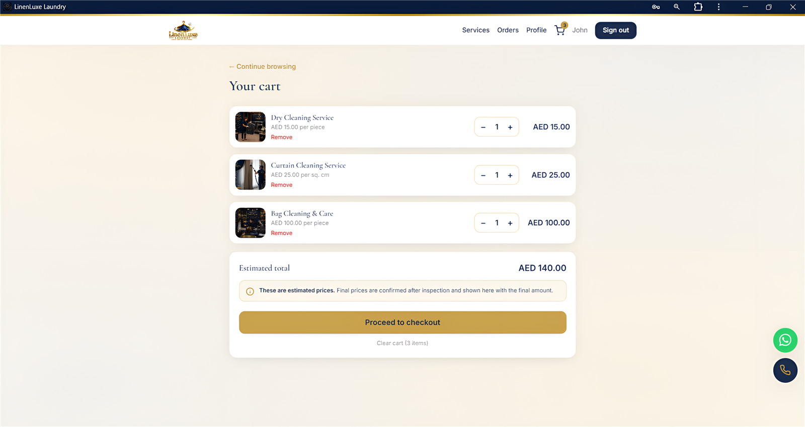
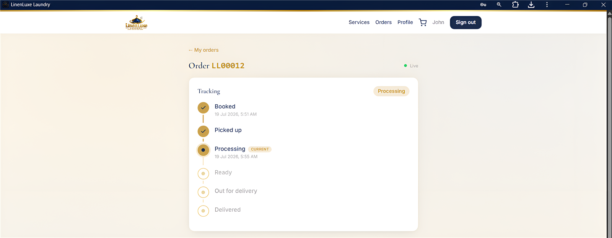
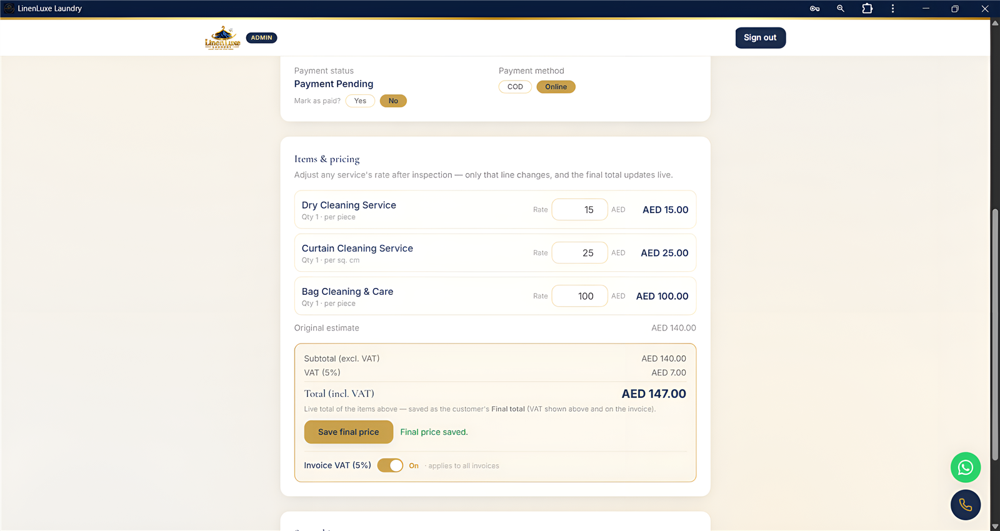

# LinenLuxe Portal

The customer-facing side of **LinenLuxe Laundry**, Dubai — an installable web app
where a customer books a pickup, watches the order move through the shop, and
downloads the invoice, and where staff price and run those orders.

**React 18 · Vite · Tailwind · React Router · Supabase (Auth, Postgres, RLS) · PWA**

### 🌐 [www.linenluxelaundry.com](https://www.linenluxelaundry.com)

The counter runs on a native Windows POS in a separate repository, against this
same Supabase project.

---

## Where customers arrive

The shop's storefront. **Book a Pickup** is what opens the app in this repository,
so everything below begins on one of these pages.



| What the shop does | Booking without an account |
|---|---|
|  |  |
| The services, each leading to the same basket. | A pickup can also be requested straight from the site, or over WhatsApp — not everyone wants to sign up first. |

---

## What it looks like

| The basket, before anything has been seen |
|---|
|  |
| Prices here are an **estimate** and the page says so, because what a garment costs depends on what is on it. |

| Tracking an order | Pricing it after inspection |
|---|---|
|  |  |
| The customer follows the order through the shop in the same six steps the staff screen uses. | Staff adjust the rate of a single line; the original estimate stays on screen beside the new total, and only then does the invoice stop saying ESTIMATE. |

---

## What it does

**For the customer**
- Browse the full price list — 163 items across eight categories — add to a basket
  and check out, choosing Clean & Press or Press Only per item
- Pickup address kept on the account, and **snapshotted onto the order**, so a later
  change of address never rewrites where a past order was collected from
- Track an order through booked → picked up → processing → ready →
  out for delivery → delivered
- Download the invoice as a PDF, generated in the browser
- Installs to the phone's home screen and keeps working through a weak signal

**For staff**
- Dashboard of live orders, and per-order pricing
- **Estimate first, final price after inspection.** An item is quoted from the price
  list, then repriced once it has been seen; until that happens the invoice is
  marked `ESTIMATE`, and the customer is told which is which
- Payment method and status, order status, and team management for admins

**Roles** are enforced in the database, not the interface: Row Level Security
decides what a customer, a staff member and an admin can each read and write, so a
crafted request from the browser gets nowhere.

---

## How it is built

```
src/
├─ pages/          # one per route — Services, Cart, Checkout, OrderHistory,
│                  #   OrderDetail, Profile, StaffDashboard, StaffOrderDetail, …
├─ components/     # AppHeader, ServiceCard, OrderTimeline, ProtectedRoute, …
├─ context/        # AuthContext, CartContext
├─ lib/
│  ├─ supabase.js      # the one client
│  ├─ invoice.js       # the PDF, drawn with jsPDF
│  ├─ numberToWords.js # "One Hundred Forty-Two Dirhams and Eighty Fils Only"
│  ├─ orderStatus.js   # the lifecycle, in one place
│  └─ address.js, format.js, brand.js, settings.js
supabase/
├─ 01_schema.sql … 11_…  # every migration, numbered, in the order applied
└─ functions/            # Supabase edge functions (Deno)
   ├─ admin-set-password/   # admin-only password reset
   └─ notify-new-order/     # order notification
scripts/                 # icon generation, font fetching, invoice smoke test
```

**The invoice is a document, not a screenshot.** `lib/invoice.js` draws it with
jsPDF — a real vector PDF with the brand's own lettering, the amount written out in
words, and the terms a laundry needs on paper. The Windows POS carries a 1:1 port of
this routine, so the customer gets the same invoice whichever side raised it.

**Migrations are files, in order.** Every schema change is a numbered SQL file that
can be read, reviewed and re-run, rather than clicks in a dashboard nobody can
audit later — and each one carries the reasoning for the change at the top of it.
`04_fix_role_escalation.sql` is a fair sample: a trigger stops a signed-in customer
from promoting themselves, but as first written it reverted *every* role change,
including legitimate ones made from the SQL editor where there is no `auth.uid()`.
The fix narrows it to the attack it was for. The whole exchange is in the file.

**Edge functions hold no secrets.** The service-role key is injected by Supabase at
run time and read from the environment — it is never in the source, and never in
the browser bundle.

---

## Running it

1. ```
   npm install
   ```
2. Copy `.env.example` to `.env` and fill in your Supabase project URL and
   publishable key — both are browser-safe, and the database is protected by RLS.
3. Apply `supabase/01_schema.sql` … `11_…` in order in the Supabase SQL editor.
4. ```
   npm run dev
   ```

`npm run build` produces a static bundle; the PWA service worker and caching
headers are configured in `vite.config.js` and `public/_headers`.

## Security

- No key is hard-coded. `.env` is gitignored and has never been committed; only
  `.env.example`, with placeholders, is in the repository.
- The browser only ever holds the **publishable** key. Every table is governed by
  Row Level Security, and role changes are gated separately from ordinary writes.
- Server-only secrets live in Supabase's own environment, reachable only by the
  edge functions.
